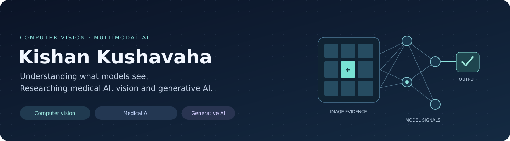
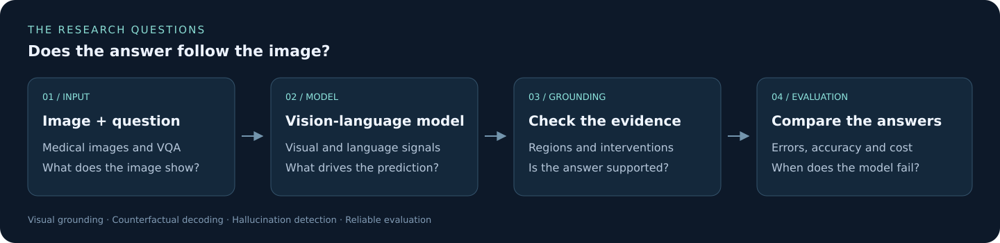

I completed my M.Tech in Computer Science at IIT Jammu. My main interests are **computer vision, vision-language models and generative AI**.

I am interested in how models use image evidence and why they sometimes generate unsupported answers. My current focus is **hallucination detection, visual grounding and evaluation**, especially for medical images.

[LinkedIn](https://www.linkedin.com/in/kishan-kushavaha-326a42238/) · [Email](mailto:kk3822065@gmail.com) · [Research notes](https://github.com/kishan8354/research-project) · [Paper collection](https://github.com/kishan8354/survey-paper-collection)

## Research focus

- Hallucination detection and mitigation in VLMs.
- Visual grounding, image-text alignment and multimodal reasoning.
- Medical visual question answering and report generation.
- Counterfactual decoding and efficient visual-token processing.

## Multimodal models & VLM research

- **[VGS-Decoding](https://github.com/kishan8354/VGS-Decoding)** — my independent implementation of visual-grounding-guided decoding for medical VLMs.
- **[Research project](https://github.com/kishan8354/research-project)** — related papers, research questions and experiment plans for hallucination and grounding.
- **[Survey paper collection](https://github.com/kishan8354/survey-paper-collection)** — papers grouped by year, datasets, 2D/3D inputs, tasks and evaluation metrics.

## GenAI & LLM applications

I am interested in language models, retrieval and evidence-based answers, alongside my work on vision-language models.

- **[Daily LLM Revision](https://github.com/kishan8354/Daily-Task-Remainder)** — Gemini-powered coding revision and spaced-repetition automation.
- **[Data Query API Prototype](https://github.com/kishan8354/mini-data-query-simulation)** — a Flask prototype that simulates natural-language data queries and explanations.

## Computer vision & deep learning models

- **[Brain Tumor Classification](https://github.com/kishan8354/Brain-tumor-detection)** — CNN and transfer-learning practice for brain MRI classification.
- **[Handwritten Digit Recognition](https://github.com/kishan8354/Handwritten-Digit-Recognition)** — digit classification with TensorFlow and Keras.
- **[Autoencoder Anomaly Detection](https://github.com/kishan8354/Anomaly-detection-in-cloud-computing-networks-by-using-autoencoders)** — deep-learning experiments for network anomaly detection.
- **[Virtual Mouse](https://github.com/kishan8354/Virtual-Mouse)** — hand-gesture-based interaction using computer vision.

## Machine learning projects

- **[Stellar Classification](https://github.com/kishan8354/Predicting-Stellar-Class)** — Random Forest classification of stellar objects.
- **[Customer Segmentation](https://github.com/kishan8354/-CUSTOMER-SEGMENTATION)** — clustering and customer-behavior analysis.
- **[Titanic Survival Prediction](https://github.com/kishan8354/Titanic-Survival-Prediction)** — logistic regression and Random Forest classification.
- **[Big Mart Sales Prediction](https://github.com/kishan8354/Big-Mart-sales-prediction)** — regression models for retail-sales prediction.
- **[Diabetes Prediction](https://github.com/kishan8354/Diabetes_prediction_Machine_learning)** — a prediction notebook and model application.

## Learning & implementation

[Daily learning](https://github.com/kishan8354/daily-learning) is where I keep my PyTorch, attention, Transformer and computer vision practice. I use the notes to record what I run, what goes wrong and what I need to understand next.

**Tools:** Python · PyTorch · TensorFlow · NumPy · pandas · scikit-learn · OpenCV · Jupyter · Git · Linux

Other work: systems & security

- [Adaptive Memory Allocation](https://github.com/kishan8354/Adaptive-Memory-Allocation)
- [ESP32 Rogue AP Detection](https://github.com/kishan8354/ESP32-Based-Rogue-AP-Detection-System)
- [Extension Threat Detector](https://github.com/kishan8354/Extension-Threat-Detector-ETD-)
- [Wireless Anomaly Detector](https://github.com/kishan8354/wireless-anomaly-detector)

